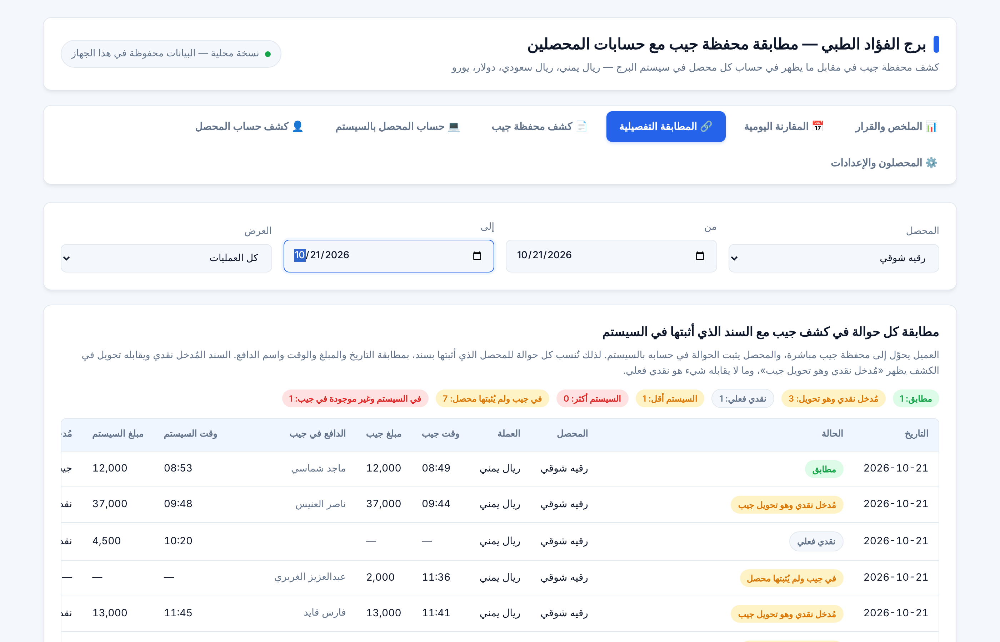

# برج الفؤاد الطبي — نظام مطابقة محفظة جيب

نظام لمطابقة كشف **محفظة جيب** مع حسابات **المحصلين** في سيستم البرج، بعملات: ريال يمني، ريال سعودي، دولار، يورو.

العميل يسدد نقداً للمحصل أو بتحويل مباشر إلى محفظة جيب، ثم يثبت المحصل المبلغ في حسابه بالسيستم. النظام يقابل كشف جيب (حوالات جميع المحصلين) بسندات كل محصل، فيحدد صاحب كل حوالة، ويفرز النقدي من التحويل، ويُخرج لكل محصل كشف حساب مستقلاً مع النقد الفعلي المطلوب منه.



## المزايا

- استيراد كشف محفظة جيب PDF وقراءته سطراً بسطر، مع التحقق من أن الرصيد الافتتاحي + صافي الحركة = الرصيد الختامي.
- استيراد كشف المحصل من السيستم بأي صيغة: PDF، Excel، Word، صورة أو تصوير بالكاميرا، مع جدول مراجعة قبل الحفظ.
- مطابقة عملية بعملية: مطابق، مُدخل نقدي وهو تحويل جيب، نقدي فعلي، السيستم أقل/أكثر، غير موجودة في جيب، في جيب ولم تُثبت.
- كشف حساب لكل محصل قابل للطباعة، وملخص يومي، وقرار مقترح لكل فرق.
- دخول باسم مستخدم ورمز، بصلاحيتي مدير ومستخدم.
- يعمل على الجوال والكمبيوتر.

## نسختان

| | `apps-script/` (Google Sheets) | `index.html` (ملف واحد) |
|---|---|---|
| البيانات | مشتركة بين كل الأجهزة في جدول Google Sheets | على الجهاز الذي فُتح عليه فقط |
| الإنترنت | مطلوب | غير مطلوب |
| قراءة كشف المحصل (صور، Excel، Word) | نعم | لا — يُدخل يدوياً |
| النسخ الاحتياطي | تلقائي (سجل إصدارات Google Sheets) | يدوي بزر داخل النظام |

### تثبيت نسخة Google Sheets

1. أنشئ جدول Google Sheets جديداً.
2. الإضافات ← Apps Script.
3. الصق محتوى `apps-script/Code.gs` في `Code.gs`.
4. أضف ملف HTML باسم `Index` والصق فيه محتوى `apps-script/Index.html`.
5. الخدمات (Services) ← `+` ← Drive API ← إضافة.
6. نشر ← نشر جديد ← تطبيق ويب: التنفيذ باسم «أنا»، الوصول «أي شخص».
7. افتح الرابط المنتهي بـ `/exec` وأنشئ حساب المدير.

التفاصيل بالصور في [`docs/دليل-التثبيت.pdf`](docs/دليل-التثبيت.pdf).

### تشغيل نسخة الملف الواحد

نزّل `index.html` وافتحه في Google Chrome. أو فعّل GitHub Pages لهذا المستودع (Settings ← Pages ← Branch: `main`) فيعمل من الرابط.

## الملفات

```
apps-script/Code.gs      كود الخادم (Google Apps Script)
apps-script/Index.html   واجهة النظام
index.html               نسخة الملف الواحد (تعمل بدون إنترنت)
docs/                    دليل التثبيت، دليل الاستخدام، صور الشاشات
```

## الخصوصية

لا تُرفع أي بيانات مالية إلى هذا المستودع. بيانات البرج تبقى في جدول Google Sheets الخاص به، أو في متصفح الجهاز في نسخة الملف الواحد.

---

إعداد: أصيل أمين — واتساب 0553678892
